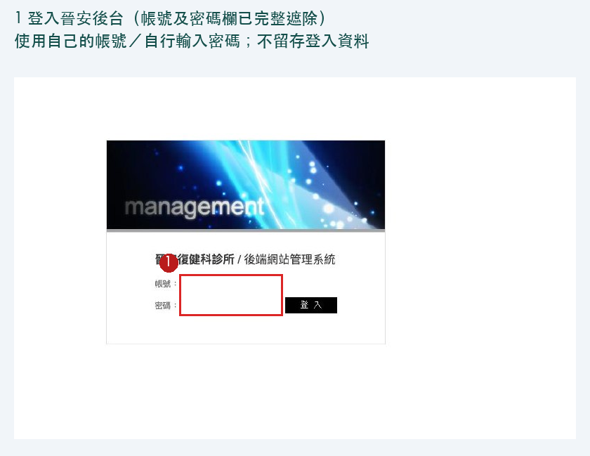
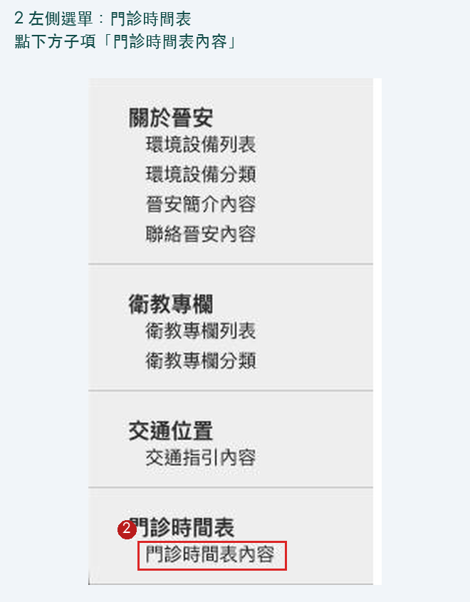
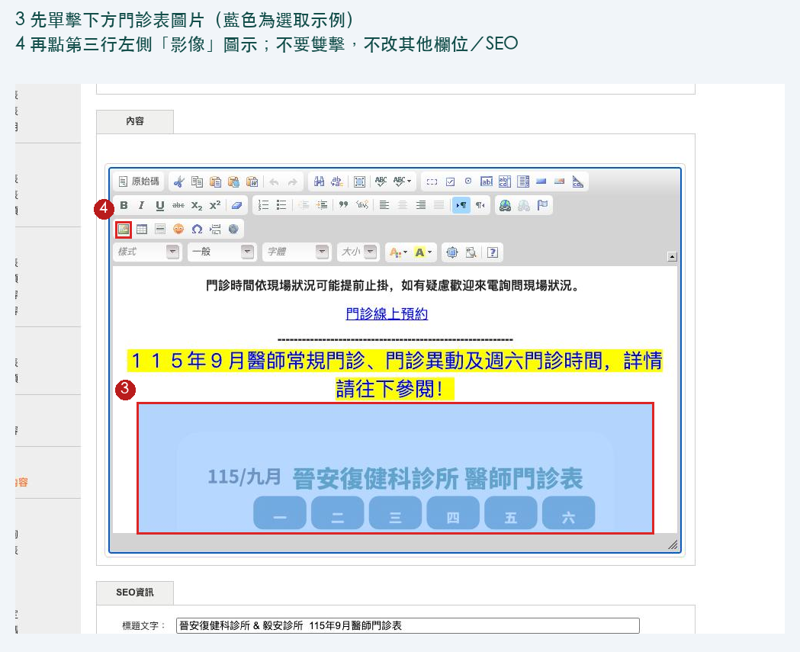
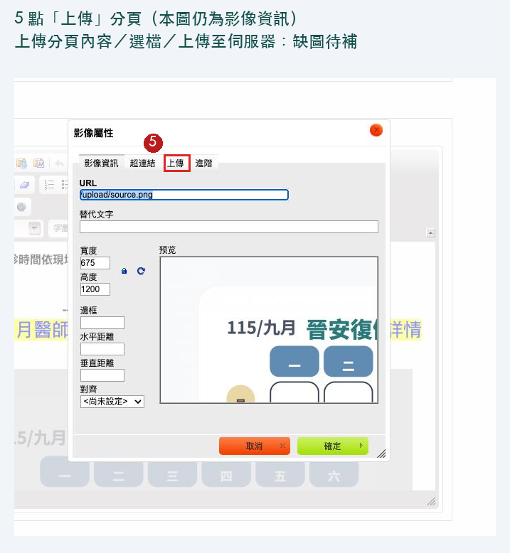
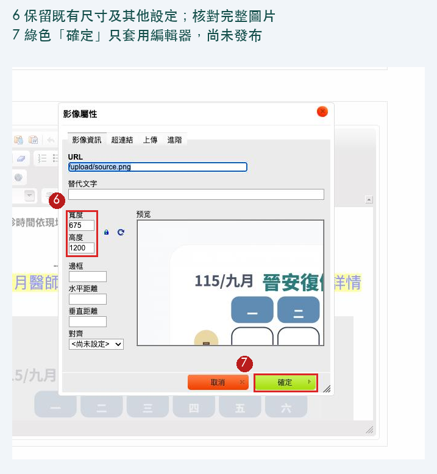

# 官網門診表操作手冊

適用對象：經授權協助更新門診表的同事。請先看對應診所的章節。

儲存門診資料、下載 PNG、開啟後台，都不代表已發布。完成後必須到公開頁查看實際圖片。

## 操作前確認

- [ ] 已取得本次發布授權，使用有權限的既有帳號；不在手冊、截圖或紀錄中留下密碼。
- [ ] PNG 已經人工核准，圖片內的診所、月份、門診異動與公告都正確，沒有過期或拿錯檔案。
- [ ] 圖片清楚、整張完整、比例正常；不自行補寫未確認的資訊。
- [ ] 確認正在操作的診所與頁面。登入失敗或無法確認時，停止並聯絡主管。

## 晉安：已確認的換圖流程

以下四張真實 CMS 截圖僅適用晉安；影像視窗重複標註為兩個步驟。登入欄位已完整遮除。截圖中的 **115年9月僅為示例，每次都要核對實際發布月份**，不可沿用示例月份。

後台：[晉安門診時間表編輯頁](https://www.tainanrehab.com/admin/index.php?op=time&sub=set)

公開驗收：[晉安公開門診表](https://www.tainanrehab.com/time.html)

1. **登入並核對頁面。** 使用有權限的既有帳號，確認是晉安「門診時間表」編輯頁，以及本次核准的 PNG。

登入後，左側「門診時間表」下點子項「門診時間表內容」，確認進入正確編輯頁。

2. **留下更新前的比對資料。** 到公開門診表下載舊圖片，或截圖保存公開頁，放在本次工作資料夾。截圖只是比對參考，不是完整還原備份；下載舊圖也不包含後台的所有設定。需要完整備份或還原時，請主管安排管理員處理。
3. **選取要換的圖片。** 單擊既有門診表圖片，再點工具列的「影像／影像屬性」。不要雙擊：可能開到超連結設定，並沒有選到要換的圖片。

4. **上傳一次。** 在影像視窗的「上傳」分頁，選擇本次核准 PNG，再點「上傳至伺服器」一次。若本次核准圖片已上傳或不確定是否已上傳，立即停止並請主管確認；不要自行找圖片網址，也不要重複上傳。

**缺圖待補：上傳分頁內容、檔案選擇器與「上傳至伺服器」。** 點「上傳」後，選擇本次核准 PNG，再點「上傳至伺服器」一次。這些畫面尚未提供，不以仿製介面代替；找不到相符操作就停止請主管確認。

5. **檢查圖片，再套用到編輯器。** 確認整張圖片完整、不裁切、文字清楚、比例正常；保留既有顯示設定與尺寸，不自行調整。點影像視窗的「確定」只會套用到編輯器，尚未提交整頁，也尚未發布。

圖中的預覽只顯示圖片局部，**不能據此認定原圖被裁切**；仍須檢查完整圖片。`upload/source.png` 只是截圖示例，不是要手動輸入的固定網址；由上傳結果帶入，不自行改填。圖示尺寸只用來辨識既有欄位，保留原設定，不重新縮放 PNG。

6. **送出前再看一次。** 確認編輯器內的門診表正確，其他欄位、圖片與連結都未變動。對照更新前的公開頁；若有人同時修改，停止並聯絡主管。
7. **整頁送出一次。** 捲到整頁最下方，找到「訊息確認」標題，點它下方真正的「送出」按鈕一次。標題本身不是按鈕。若回應不明，不要再點；記錄「可能已送出」並聯絡主管。

**缺圖待補：整頁最下方「訊息確認」與真正的「送出」按鈕。** 目前沒有完整頁底截圖。捲到整頁底部確認標題下的按鈕，再送出一次；影像視窗的綠色「確定」不是這個發布按鈕。

8. **到公開頁驗收。** 用手機或無痕視窗開啟上方「晉安公開門診表」，重新整理並查看實際圖片，逐項完成下列清單。不能只憑後台成功訊息判定完成。

### 晉安公開驗收清單

- [ ] 實際顯示的是本次核准圖片，診所是晉安、月份正確，公告與異動內容一致。
- [ ] 放大查看文字仍可讀；整張圖片完整，沒有裁切、模糊或比例變形。
- [ ] 其他公開內容未被意外更動。
- [ ] 每項都能確認才回報完成；不明時先停止，不以再次上傳或送出來刷新結果。

## 毅安：準備與驗收清單草稿，後台換圖步驟待確認

**本章尚不能作為完整的後台操作手冊。目前停止後台發布操作。**

公開驗收：[毅安公開門診表](https://www.ian-tainan.com/time.html)。已由官方首頁的「門診時間表」連結確認；這是公開頁，不是管理後台入口。

頁面目前有毅安門診表、晉安門診表、門診異動表及週六門診表四張圖。先確認主管指定更新哪張，保留其他圖，不用單一 PNG 覆蓋整頁多圖。

後台登入URL：使用者提供 — [毅安後台登入頁](https://www.ian-tainan.com/admin/login.php)。僅依使用者提供網址設定連結，未連線驗證；開啟連結不授權自動登入、上傳或送出。

內部換圖流程/截圖：待確認。登入後的編輯位置、圖片上傳與選取流程、整頁送出方式仍未知。不照搬晉安的操作。

### 現在可準備

- [ ] 確認本次發布授權及具權限的既有帳號；不記錄密碼。
- [ ] 備妥人工核准 PNG，確認毅安、月份、公告與門診異動，沒有過期或拿錯檔。
- [ ] 等主管確認實際流程後再操作；目前不上傳、不送出。

### 待流程確認後的驗收草稿

- [ ] 依確認後的步驟留下舊圖片或公開頁截圖；截圖只是比對參考，不是完整還原備份。
- [ ] 用手機或無痕視窗開啟上方「毅安公開門診表」，重新整理並查看實際圖片；不要用已知首頁代替驗收目的地。
- [ ] 核對主管指定圖片的診所、月份、公告、文字清晰、整張完整及比例正常，其他內容未被更動。
- [ ] 不能只看後台成功訊息。若結果不明，立即停止並聯絡主管；不重複上傳或送出。送出結果不明時記錄「可能已送出」。

## 遇到問題：先停止

以下狀況都不重試、不重複上傳或送出、不刪除舊圖片、不修改其他欄位。請聯絡主管，說明診所、操作時間、停在哪一步與看到的狀況；紀錄或截圖不要包含密碼。

| 狀況 | 接下來怎麼做 |
| --- | --- |
| 登入失敗、帳號無權限 | 停止，請主管確認權限，不反覆嘗試。 |
| 診所或頁面不對、找不到相同按鈕 | 停止，請主管確認正確位置，不猜路徑。 |
| 月份或檔案過期、診所或公告不符 | 停止，請主管確認核准檔案。 |
| 本次圖片已上傳，或不確定是否已上傳 | 停止，由主管安排確認；同事不用處理圖片網址，不再上傳。 |
| 圖片模糊、裁切或比例異常 | 停止，保留原設定，請主管確認圖片與顯示方式。 |
| 按送出後沒有明確回應，或公開頁仍是舊圖 | 記錄「可能已送出」，停止並請主管確認；不要再次送出或上傳。 |
| 他人同時修改、其他欄位或圖片變了、任何結果不明 | 停止，請主管處理；需要還原時另取得授權。 |

## 進階備註：僅供管理員

以下不是同事換圖時的必做清單。

- 晉安既有顯示尺寸為 **675 × 1200**。這是保留既有設定的參考，不是要求重新縮放 PNG，也不是所有官網的通用尺寸。海報產生器的 PNG 下載設定不因本手冊而改變。
- 完整還原備份需保存公開 HTML、目標圖片的原始內容、舊圖片 URL、屬性與顯示設定，以及 SHA-256 等比對資料。公開頁截圖不能取代這些資料。
- 管理員可核對 CMS 衍生圖與公開實際圖片的 URL、內容及 hash，並比較其他 HTML、連結與欄位是否維持原狀；後台成功訊息不能取代公開內容驗證。
- 已有核准上傳圖片時，由管理員確認既有圖片；不要要求同事自行複製 URL 或再次上傳。結果不明時僅做唯讀核對；還原需另有授權。
- 毅安的已確認公開門診表不能證明其後台流程與晉安相同。
